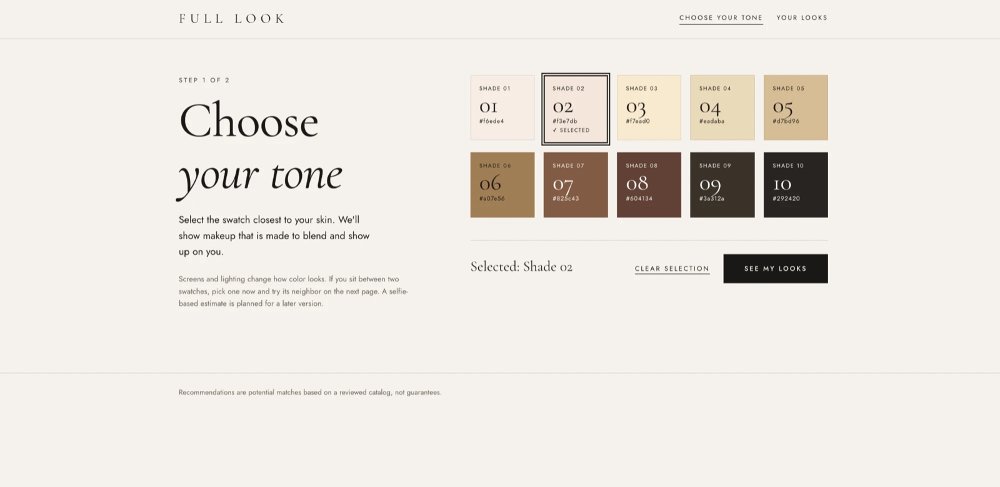

# Full-Look Makeup Matcher 💄

A makeup recommendation app for people of color, with particular care for deeper complexions. You choose one of 10 skin tone swatches and get makeup matched to that tone, with the source and review status of every match.

## Status: Demo Day checkpoint (Monday, October 26, 2026)

## Screenshot

## Tech Used

- HTML, CSS, vanilla JavaScript (`fetch().then().catch()`)
- Node.js and Express
- MongoDB with Mongoose
- dotenv, csv-parse

## How to Use

 
## Project Layout

## Author

Maya Rose 🌹
